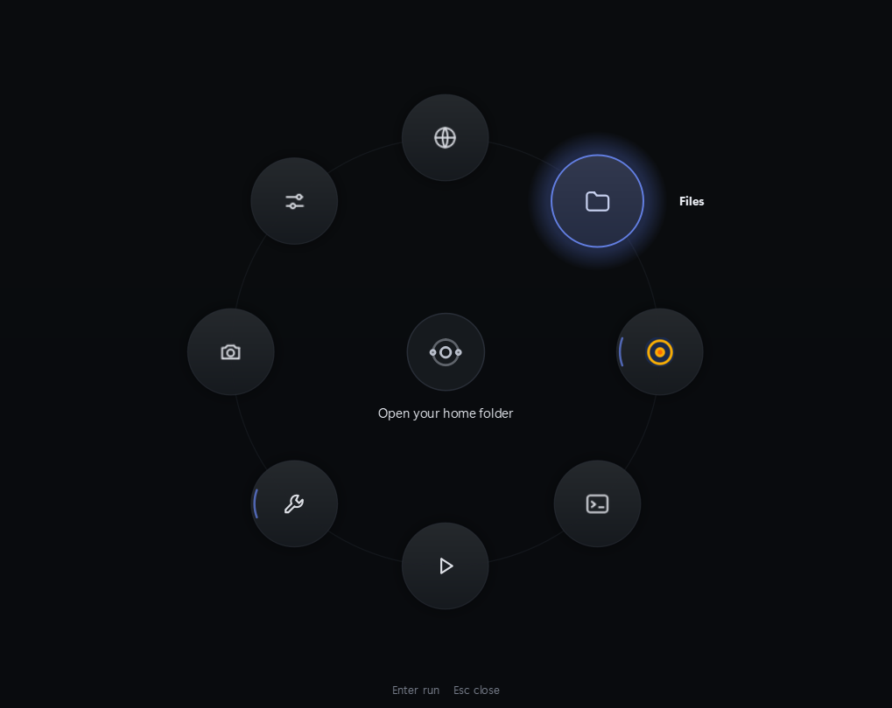
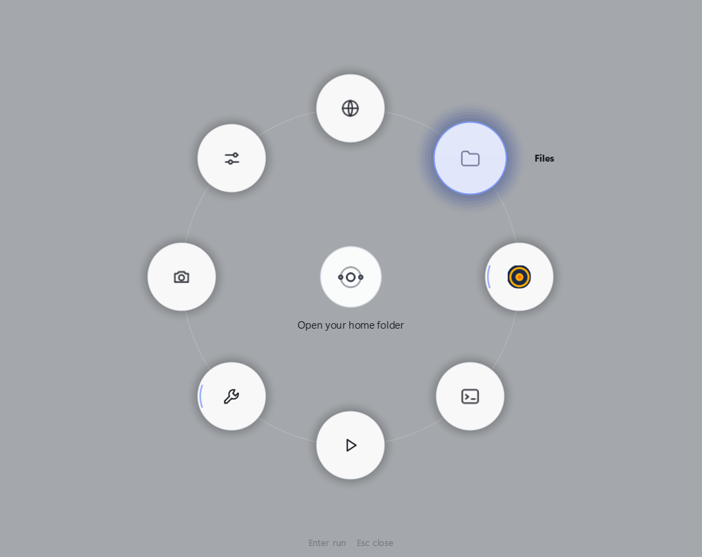
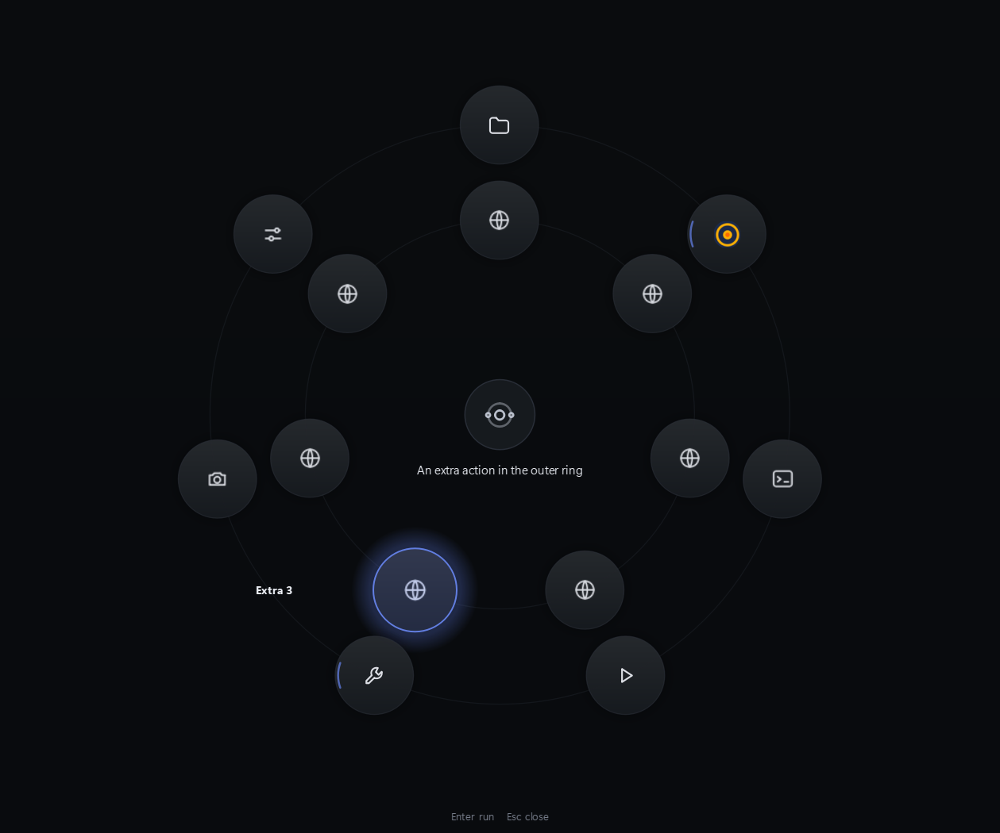
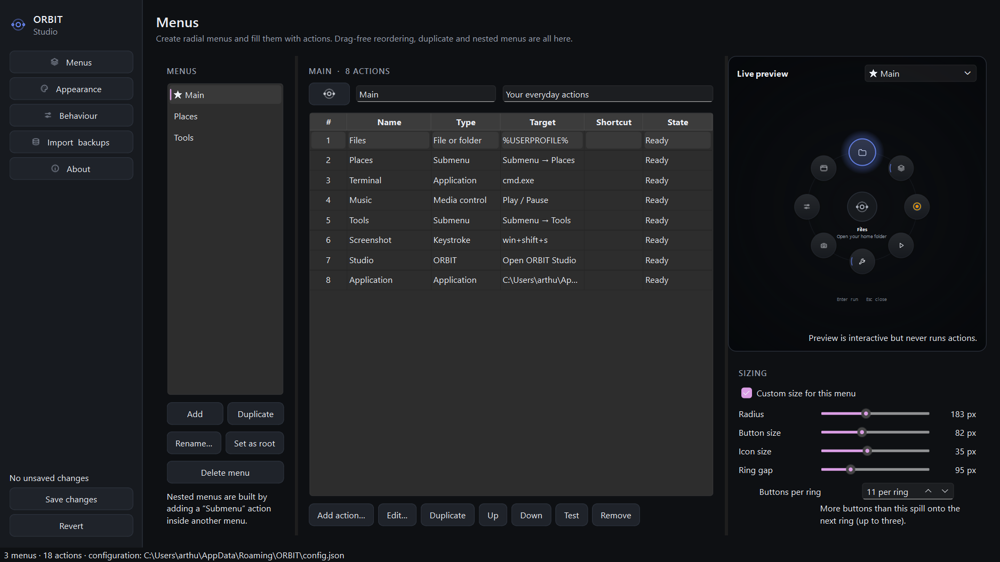
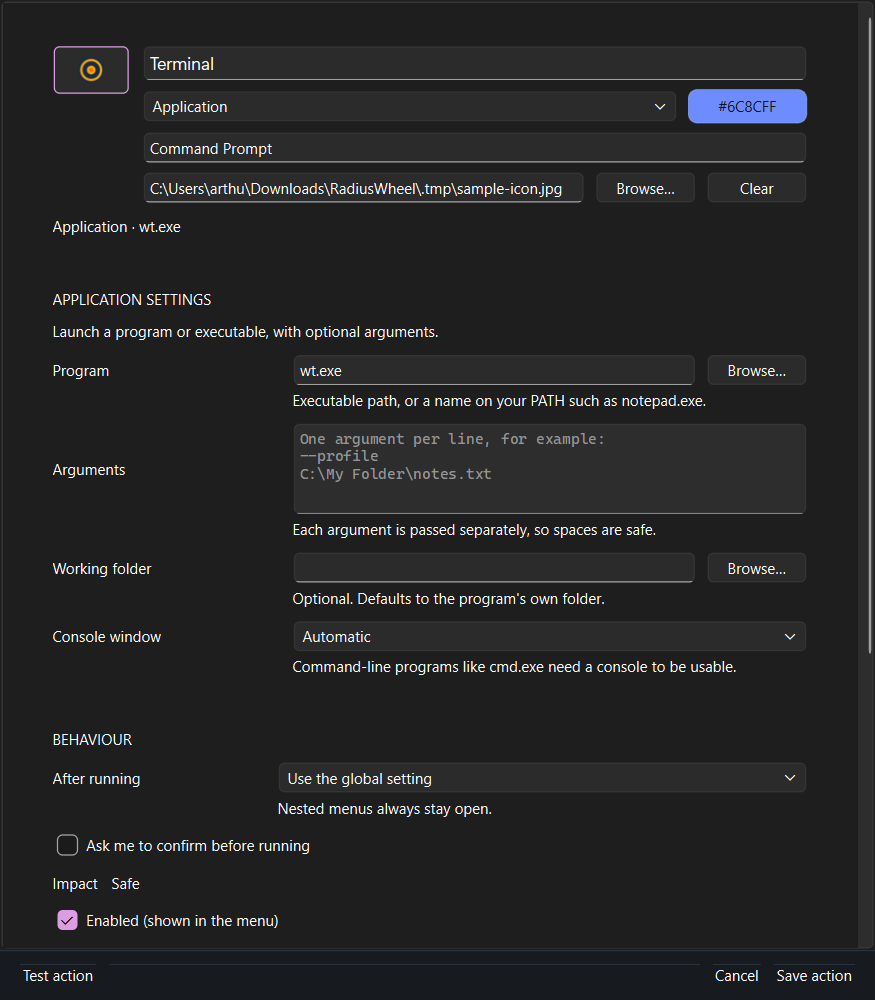
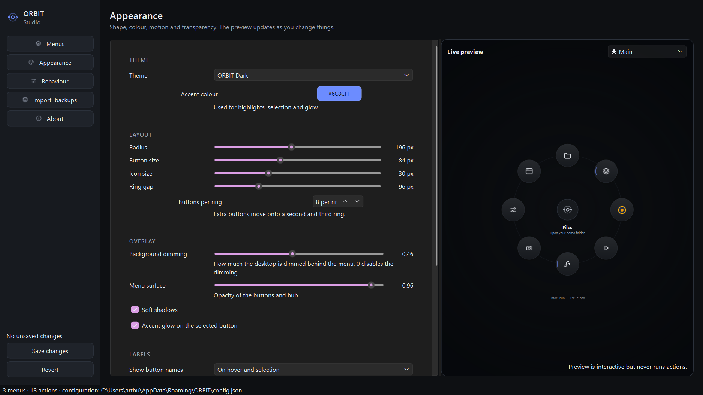
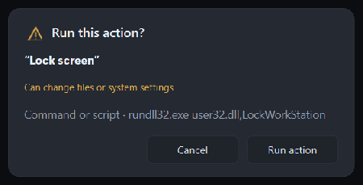

# ORBIT — a customizable desktop action wheel

ORBIT is a Windows desktop utility: press one shortcut, get a radial action wheel in the
middle of your screen, and launch apps, folders, sites, scripts and sequences without
hunting through the taskbar. It lives in the tray, stays out of the way, and every action
is configurable in **ORBIT Studio** — no JSON editing required.



---

## Contents

- [What it does](#what-it-does)
- [Install and run](#install-and-run)
- [Using the wheel](#using-the-wheel)
- [Action types](#action-types)
- [ORBIT Studio](#orbit-studio)
- [Configuration, backups and import/export](#configuration-backups-and-importexport)
- [Command line](#command-line)
- [Build ORBIT.exe](#build-orbitexe)
- [Architecture](#architecture)
- [Tests](#tests)
- [Safety](#safety)
- [Limitations worth knowing](#limitations-worth-knowing)
- [Troubleshooting](#troubleshooting)

---

## What it does

- **Radial action wheel** on a transparent overlay that dims one monitor, centred on the
  monitor under your cursor (or a monitor you choose). One to three concentric rings.
- **Nested menus.** A button can open another wheel — "Projects" → folders and apps.
- **Ten action types**, all data-driven: application, file/folder, website, image, media
  control, command/script, action sequence, submenu, keystroke, and ORBIT commands.
- **Global activation shortcut** through the Windows hotkey API, so it works while another
  app has focus. If the combination is taken, ORBIT says so and falls back to a backup
  shortcut.
- **Readable at a glance.** Point at a button and its name appears next to the icon and its
  purpose under the hub — instantly, with no key press. Keyboard selection shows the same
  information, so the wheel is fully usable without a mouse.
- **ORBIT Studio** with a live, real interactive preview of the wheel while you edit it.
- **Tray icon** with open-studio, reload-config, pause-shortcut and quit.
- **No accounts, no cloud, no network.** The only runtime dependency is PySide6.

| Dark (default) | Light |
| --- | --- |
|  |  |

Two rings appear automatically when a menu has more buttons than `max_per_ring`:



---

## Install and run

Requirements: **Windows 10 or 11**, **Python 3.10+** (tested on 3.14), and ~120 MB of disk
for PySide6. No administrator rights are needed at any point.

In **PowerShell** (or `cmd`), from this folder:

```powershell
py -3 -m venv .venv
.venv\Scripts\python.exe -m pip install -r requirements.txt
.venv\Scripts\python.exe main.py
```

If `py` is not available, use `python` instead of `py -3`. In `cmd` the paths are the same;
in PowerShell you can also activate the environment with `.venv\Scripts\Activate.ps1`.

Then press **Alt + Space**. The wheel opens on the monitor under your mouse.

**Start it without a console window** (normal daily use):

```powershell
.\run_orbit.bat
```

`run_orbit.bat` uses `pythonw.exe`, so nothing sits in your taskbar. To stop ORBIT, use the
tray icon → **Quit ORBIT**.

**Start with Windows:** ORBIT Studio → **Behaviour** → *Start ORBIT when I sign in*. This
writes a per-user `HKCU\Software\Microsoft\Windows\CurrentVersion\Run` entry — no admin
rights, and it can be switched off again in the same place.

Optional extras (not required):

```powershell
.venv\Scripts\python.exe -m pip install winsdk    # media control through Windows media sessions
.venv\Scripts\python.exe -m pip install pynput    # global shortcut on macOS/Linux
```

---

## Using the wheel

It opens with a short bloom animation. The selected button glows, its name and description
sit under the hub, and the hub itself is a button: it closes the wheel, or goes back one
level when you are inside a nested menu.

| Input | Result |
| --- | --- |
| `Alt + Space` (configurable) | Open / close the wheel from anywhere |
| Move the mouse | Select the button under the cursor |
| Left click | Run the selected action |
| `↑` `↓` `←` `→` / `Tab` | Cycle the selection |
| Mouse wheel | Cycle the selection |
| `Enter` / `Space` | Run the selected action |
| `1` … `9` | Run that button directly |
| First letter of a name | Jump to that button |
| `Backspace` | Go back to the previous menu (nested wheels) |
| `Esc` | Close the wheel |
| Click outside the wheel | Close the wheel |
| Click the hub | Back (nested) / close |

Every one of those dismissals is a real path, and there is an internal safety timer as well:
the overlay can always be closed, even if an animation is interrupted. Optional auto-close
after a delay lives in **Behaviour → Close automatically after**.

After an action runs the wheel closes by default. Per action you can choose **Keep the
menu open**, and actions marked *needs confirmation* ask first.

Long-running actions (captured commands, sequences) show a notification with a **Cancel**
button while they run; the interface never blocks.

---

## Action types

| Type | What it does | Notes |
| --- | --- | --- |
| **Application** | Launches an executable with optional arguments | Arguments are passed one by one, so spaces and non-English characters are safe. Console programs (`cmd.exe`, `pwsh.exe`) get a console window automatically; this is configurable. |
| **File or folder** | Opens a path with its default handler | Optional "show in Explorer" mode opens the parent with the item selected. |
| **Website** | Opens a URL in the default browser | Only `http`, `https`, `mailto`, `file` and known app schemes are accepted; invalid addresses are rejected before saving. |
| **Image** | Opens a picture in the default viewer **or** the built-in ORBIT viewer (zoom, pan, `Esc` to close) | |
| **Media control** | Play/pause, next, previous, stop, volume | Three methods: *system media keys* (works with any player that handles them), *Windows media session* (needs the optional `winsdk`), or a *player command* you configure. No player API is assumed. |
| **Command or script** | Runs a program/script with a working folder and arguments | Runs directly — **not** through a shell — unless you enable *Run through cmd.exe*. Optional wait + output capture, timeout, console window. |
| **Action sequence** | Runs several actions in order, with optional delays | Choose whether a failing step stops the sequence. Nested sequences are depth-limited. |
| **Submenu** | Opens another wheel | Multiple levels; cycles are refused by validation and by the overlay. |
| **Keystroke** | Sends a key combination to the focused window | e.g. `win+shift+s`, `ctrl+shift+t`, `alt+tab`. The wheel hides first and waits briefly so the previous window gets focus back. |
| **ORBIT** | Open Studio, open the config folder, reload the config, toggle the wheel, quit | |

Every action also supports: name, icon (built-in glyph library, **any picture file Qt can
read** — PNG, SVG, JPG, WEBP, GIF, BMP, TIFF, ICO, XPM… cropped into a circle — or short
text), description, keyboard shortcut badge, per-action accent colour, ordering,
confirmation, close/hide behaviour, enabled flag and **visibility conditions**
(*only when this path exists*, *only when this app is running*).

The wheel is rendered entirely from these records, so the editor, the preview and the
overlay never disagree.

### Adding a new action type

Add one `ActionTypeSpec` in [core/action_registry.py](core/action_registry.py#L1): a key, a
label, a list of `Field` descriptors (which the editor turns into controls automatically),
a validator and a runner. The radial menu, the studio and the executor all pick it up with
no UI changes.

---

## ORBIT Studio

Studio is where everything is configured. It edits a working copy; nothing is written until
you press **Save changes**, and every save backs up the previous file.



**Menus** — create, rename, duplicate and delete wheels, choose the root wheel, set a wheel
icon, add/edit/duplicate/reorder/remove actions, test an action, and see a live preview.
Per-wheel sizing overrides (radius, button size, icon size, ring gap, buttons per ring) are
here too.

**Action editor** — a form generated from the action type's schema, with Browse buttons for
executables/files/folders, an icon picker, a **picture field** for any image format (the
round preview at the top shows exactly what the wheel will draw), an argument editor (one
argument per line), a step editor for sequences, visibility rules, and continuous
validation. Problems are listed before you save; "Save anyway" is offered but never silent.



**Appearance** — theme (dark, light, or custom colours), accent colour, radius, button and
icon size, ring gap, buttons per ring, background dimming, surface opacity, shadows, glow,
label mode, descriptions, shortcut badges, animation duration, easing curve, and reduced
motion. The preview on the right updates as you change values.



**Behaviour** — activation shortcut (click the field and press the combination; **Apply now**
registers it immediately), backup shortcut, close-after-running, `Esc`/click-outside
dismissal, auto-close delay, confirmation for destructive actions, startup with Windows,
tray icon, notifications, error feedback (tray flash / system beep), and which monitor the
wheel opens on.

**Import & backups** — export/import JSON with validation, a list of timestamped backups with
one-click restore, open the config folder, and restore the defaults (with a backup first).

**About** — version, counts, file locations, quick start and log access.

### Confirming destructive actions



Actions marked *needs confirmation* (and every ORBIT created action of a risky type starts
that way) ask before they run. The impact line tells you whether the action can change files
or system settings.

---

## Configuration, backups and import/export

ORBIT keeps everything in one JSON file:

```
%APPDATA%\ORBIT\config.json            the live configuration
%APPDATA%\ORBIT\backups\              timestamped backups (last 25 kept)
%APPDATA%\ORBIT\logs\orbit.log        rotating log file
```

Set `ORBIT_DATA_DIR` to use a different folder (useful for testing or a portable setup).
`--config PATH` points ORBIT at a specific config file.

Shape of the file:

```jsonc
{
  "version": 2,
  "root_menu_id": "main",
  "settings": { "hotkey": "alt+space", "theme": "orbit-dark", "accent": "#6C8CFF", "...": "..." },
  "menus": [
    {
      "id": "main",
      "name": "Main",
      "icon": "orbit",
      "actions": [
        {
          "id": "main_browser",
          "name": "Browser",
          "type": "url",
          "target": "https://www.google.com",
          "icon": "globe",
          "description": "Open your default browser",
          "order": 0,
          "confirm": false,
          "close_menu": null,          // null = use the global setting
          "visible_when": {},          // e.g. {"app_running": "spotify.exe"}
          "options": {}
        }
      ]
    }
  ]
}
```

Saving is atomic (temp file, then replace). Every save, import, restore and reset writes a
backup first, and a file that fails validation is never applied.

---

## Command line

```powershell
.venv\Scripts\python.exe main.py                 # tray + shortcut, wheel on demand
.venv\Scripts\python.exe main.py --studio        # open ORBIT Studio at launch
.venv\Scripts\python.exe main.py --background    # start quietly (used by launch on login)
.venv\Scripts\python.exe main.py --no-tray       # skip the tray icon
.venv\Scripts\python.exe main.py --config D:\orbit\my.json
.venv\Scripts\python.exe main.py --reset-config  # back up and restore defaults
.venv\Scripts\python.exe main.py --log-level DEBUG
.venv\Scripts\python.exe main.py --version
```

Only one instance runs at a time; launching a second one opens the wheel of the first.

---

## Build ORBIT.exe

```powershell
.\build_exe.bat
```

The script creates/updates `.venv`, installs PyInstaller, generates the application icon and
produces **`dist\ORBIT.exe`** (single file, no console window, ~52 MB). Double-click it and
press **Alt + Space**.

The equivalent manual command:

```powershell
.venv\Scripts\python.exe -m pip install pyinstaller
.venv\Scripts\python.exe tools\make_icon.py
.venv\Scripts\python.exe -m PyInstaller --noconfirm --clean --onefile --windowed --name ORBIT --icon assets\orbit.ico main.py
```

`tools\make_icon.py` renders `assets\orbit.ico` from the same SVG the hub uses, at seven
resolutions.

---

## Architecture

```
main.py                      application lifecycle, controller, single-instance, CLI
core/
  paths.py                   %APPDATA% locations, variable expansion
  models.py                  Action, Menu, Settings, Config + submenu cycle detection
  config_manager.py          load/save/validate/sanitize, backups, import/export, reset
  action_registry.py         action types: schemas, validation, runners (the plugin point)
  action_executor.py         execution, visibility rules, cancellation, Qt thread pool
  shortcut_manager.py        global hotkey (Win32 RegisterHotKey, conflict detection)
  launcher.py                direct process launching, default-handler opening, window focus
  media_controller.py        media keys / Windows media sessions / player commands
  keycodes.py                hotkey and keystroke notation
  startup.py                 launch on login (HKCU Run / .desktop)
  urls.py                    URL validation
ui/
  icons.py                   built-in SVG glyph library, image and text icons
  theme_manager.py           palettes, QSS, easing, fonts
  action_button.py           self-painting radial button (hover/reveal animation)
  radial_menu.py             layout, painting, selection and keyboard interaction
  radial_overlay.py          transparent always-on-top window, navigation stack, dismissal
  toast.py                   stacked notifications with a cancel action
  dialogs.py                 confirmation and result dialogs
  preview_panel.py           live preview embedding the real radial menu
  action_editor.py           schema-driven action editor, type picker, sequence editor
  radial_editor.py           menu editor page
  settings_pages.py          appearance and behaviour pages
  studio_window.py           studio shell, import/backup page, about page
  tray_manager.py            tray icon, menu and notifications
  image_viewer.py            built-in image viewer
tests/                       pytest suite (core logic + offscreen UI behaviour)
```

Rules the code follows: the core never imports Qt widgets (only `QObject`/signals for the
threaded runner), the UI never launches processes directly, and no module builds shell command
lines from user text.

---

## Tests

```powershell
.venv\Scripts\python.exe -m pip install pytest
.venv\Scripts\python.exe -m pytest
```

119 tests cover configuration validation, backups, import/export, model round-tripping,
action schemas and validation, command execution and failure reporting, cancellation,
sequence ordering and depth limits, visibility rules, close-menu precedence, hotkey and
keystroke parsing, URL validation, launch-on-login entry handling, plus offscreen UI tests
for layout geometry, keyboard navigation, preview safety, nested navigation, dismissal,
action editing, icon/image selection and studio save/revert behaviour.

The suite sets `ORBIT_DATA_DIR` to a temporary folder and fakes the operating system's
startup entry, so it never touches your real configuration or your sign-in items.

---

## Safety

- Commands are executed as **explicitly configured** programs. Text in a label, description,
  icon or name is never executed or interpreted.
- Direct process creation is the default. `shell=True`-style behaviour only happens when you
  tick **Run through cmd.exe**, and that choice is flagged as risky in the editor.
- Actions marked *needs confirmation* ask first, and the dialog names the impact.
- Imports are validated before they replace anything; every replacement is backed up.
- Submenu loops are refused by validation, by the executor and by the overlay's navigation
  stack.
- ORBIT never asks for administrator rights, installs no keyboard hooks and does not read
  your keystrokes — it only registers one hotkey with Windows.
- Running actions never block the interface, and long ones can be cancelled.

---

## Limitations worth knowing

- **Global shortcut conflicts.** `RegisterHotKey` gives ORBIT a clear error when another app
  already owns the combination; ORBIT then tries the backup shortcut and tells you. After a
  conflict, pick another shortcut in **Behaviour**.
- **Elevated apps.** A keystroke action, like any non-elevated program, cannot type into an
  elevated window or the UAC secure desktop. That is a Windows security boundary, not a bug.
  Commands that need elevation must trigger your own UAC-approved launcher.
- **Media control** depends on the player exposing the standard media keys (works for most),
  or on the optional `winsdk` package for the Windows session API, or on a CLI you configure.
  A player that does none of these cannot be controlled.
- **One monitor at a time.** The overlay covers the chosen monitor only, so the rest of the
  desktop stays usable.
- **Windows first.** The hotkey, media keys, startup entry and keystroke sender are
  Windows-specific. macOS/Linux run the UI and most actions, but need `pynput` for the global
  shortcut and have no media-key or Run-key integration.
- **Launching apps** uses the executable itself; Windows Store apps are best opened through
  their URI (`shell:AppsFolder\…` via a command action) or a URL action.

---

## Troubleshooting

| Symptom | Fix |
| --- | --- |
| Nothing happens on `Alt + Space` | Another app owns it. Check the tray tooltip or Studio → Behaviour; pick a different shortcut. |
| "The activation shortcut is not available" at startup | The fallback (`Alt + Shift + Space`) was used, or both are taken. Set your own in Behaviour → Apply now. |
| The wheel does not appear on the monitor you expect | Behaviour → **Show the menu on** (Follow the cursor / Primary / a specific monitor). |
| A button does nothing | Studio shows an *Issues* marker on that row and lists the problem in the editor. Test it there. |
| A command does not run | Check the program path with Browse. Enable *Wait and capture the output* to see the exit code and stderr in the notification. |
| Media button does nothing | Try the other method: Keys usually works; Windows media session needs `winsdk`; Player command needs the executable. |
| ORBIT starts with defaults | Your config could not be read; the reason is shown at startup and in `%APPDATA%\ORBIT\logs\orbit.log`. Your old file is untouched. |
| You want to undo a change | Studio → **Import & backups** → pick the timestamped backup → **Restore selected**. |
| The config is broken and ORBIT will not save | Studio lists the exact problems (unknown action type, submenu loop, duplicate ids, invalid shortcut) and refuses until they are fixed. Backup files are always restorable. |
| Reset everything | `python main.py --reset-config`, or Studio → Import & backups → Restore defaults. A backup is written first. |

Logs live in `%APPDATA%\ORBIT\logs\orbit.log` (rotating, UTF-8) and are reachable from
Studio → About → **Open the log file**.
